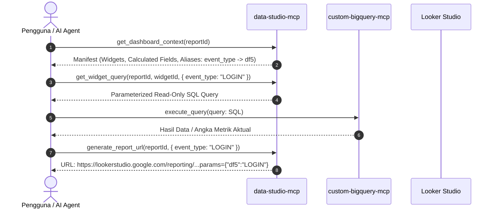

# Data Studio MCP Server (`data-studio-mcp`)

Model Context Protocol (MCP) server yang menghubungkan Agen AI (Claude Desktop, Antigravity IDE, Cursor, dll.) dengan **Google Data Studio (Looker Studio)**.

Server ini bertindak sebagai **Semantic & BI Presentation Layer**, memungkinkan agen AI memahami struktur komponen dashboard, rumus calculated fields, parameter filter, meracik SQL siap-eksekusi, dan menghasilkan deep-link interaktif tanpa risiko halusinasi numerik.

---

## 🌟 Fitur Utama

1. **Semantic Dashboard Context (<50ms):** Agen AI membaca struktur visual dashboard, metrik, dimensi, dan formula kalkulasi langsung dari manifest lokal YAML tanpa overhead browser.
2. **Dynamic Playwright RPC Crawler:** Mengintersepsi protokol internal Looker Studio (`getReport`, `getSchema`, `batchedDataV2`) untuk mengekstrak AST dashboard secara native tanpa DOM scraping yang rapuh.
3. **Orthogonal BI Architecture:** Dirancang untuk berdampingan dengan `custom-bigquery-mcp`. Server ini meracik parameterized SQL query yang kemudian dieksekusi oleh query engine MCP Anda.
4. **SQL Read-Only Guardrail:** Seluruh query yang diracik divalidasi dengan `sqlSanitizer` untuk mencegah manipulasi DDL/DML (`DROP`, `DELETE`, `INSERT`, `UPDATE`, multi-statement semicolons).
5. **Interactive Deep-Linking:** Otomatis memetakan nama field ke alias filter Looker Studio (misal `event_type` $\rightarrow$ `df5`) dan menghasilkan URL filter siap klik.
6. **Visual Verification:** Mengambil screenshot snapshot dashboard resolusi tinggi secara headless.

---

## 🛠️ Daftar Tools MCP

| Tool | Deskripsi | Input Utama | Output |
|---|---|---|---|
| `search_reports` | Mencari laporan Looker Studio via Google Drive API atau manifest lokal | `query`, `pageSize` | Daftar ringkasan dashboard |
| `inspect_dashboard_structure` | Menjelajah dashboard live via browser headless untuk memperbarui manifest | `reportId`, `forceRefresh` | Ringkasan AST & update manifest YAML |
| `get_dashboard_context` | Mengambil skema semantik dashboard, tipe komponen, dan alias filter | `reportId` | Metadata semantik & skema field |
| `get_widget_query` | Meracik template SQL query untuk widget tertentu dengan filter dinamis | `reportId`, `widgetId`, `filterValues` | Parameterized SQL query siap-eksekusi |
| `generate_report_url` | Menghasilkan URL laporan Looker Studio dengan parameter filter aktif | `reportId`, `filters` | Deep link URL Looker Studio (`?params=...`) |
| `capture_dashboard_snapshot` | Mengambil tangkapan layar visual dari dashboard | `reportId`, `pageId` | Lokasi file gambar PNG snapshot |

---

## 🚀 Memulai (Quick Start)

### Opsi 1: Penggunaan Langsung Tanpa Clone (via npx / GitHub)

#### 1. Login Sesi Google (Cukup Sekali di Terminal)
```bash
npx -y github:qybbs/data-studio-mcp login
```
*Jendela browser Google Chrome resmi akan terbuka. Silakan login ke akun Google yang memiliki hak akses ke dashboard Looker Studio Anda, lalu tekan **[ENTER]** di terminal. Sesi akan otomatis tersimpan di `~/.data-studio-mcp/storageState.json`.*

#### 2. Konfigurasi Gateway (`gateway-mcp-config.json`)
Daftarkan berdampingan dengan `custom-bigquery-mcp`:
```json
{
  "mcpServers": {
    "custom-bigquery-mcp": {
      "command": "npx",
      "args": ["-y", "github:qybbs/custom-bigquery-mcp"]
    },
    "data-studio-mcp": {
      "command": "npx",
      "args": ["-y", "github:qybbs/data-studio-mcp"]
    }
  }
}
```

#### 3. Konfigurasi Claude Desktop (`claude_desktop_config.json`)
```json
{
  "mcpServers": {
    "looker-studio": {
      "command": "npx",
      "args": ["-y", "github:qybbs/data-studio-mcp"]
    }
  }
}
```

---

### Opsi 2: Pengembangan Lokal (Clone Repository)

```bash
git clone https://github.com/qybbs/data-studio-mcp.git
cd data-studio-mcp
npm install
npm run auth:login
npm test
npm run build
```

---

## 🔄 Alur Kolaborasi Multi-MCP (Workflow)



---

## 🛡️ Prinsip Keamanan & Desain

- **Stdio Integrity:** Protokol JSON-RPC dialirkan eksklusif melalui `stdout`. Seluruh log debug dan aplikasi diarahkan ke `stderr` (`src/utils/logger.ts`) untuk mencegah kerusakan transport komunikasi MCP.
- **Strict Read-Only:** Server tidak memiliki izin menulis atau memodifikasi dashboard maupun data sumber.
- **Zero Numerical Hallucination:** Server tidak menebak atau mensimulasikan angka metrik, melainkan menyediakan query template persis yang digunakan Looker Studio.
- **Kredensial Aman:** Folder `.auth/` dan `screenshots/` dikecualikan secara ketat dari pelacakan Git.
