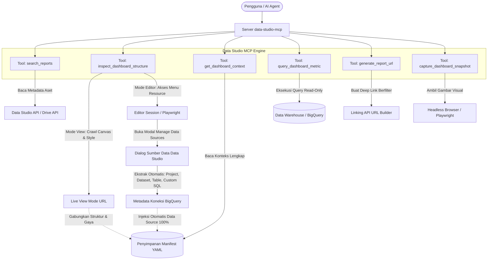

# Dokumen Kebutuhan Produk (PRD)

> **Versi Dokumen:** 1.2.0  
> **Status:** Pedoman Aktif / *North Star*  
> **Terakhir Diperbarui:** Oktober 2026  
> **Direktori Target:** `/Users/OUT2305/Repo/data-studio-mcp`  

---

## 1. Nama Aplikasi
**Data Studio MCP (`data-studio-mcp`)**  
*Server Model Context Protocol (MCP) yang menyediakan konteks semantik, query data ground-truth, inspeksi struktural, dan snapshot visual yang andal untuk dashboard Google Data Studio (sebelumnya Looker Studio).*

---

## 2. Masalah Utama (*Core Problem*)

1. **Canvas Dashboard adalah *Black Box* bagi AI:**  
   Dashboard Google Data Studio merupakan kanvas visual yang disimpan sebagai objek biner/internal tertutup. Tidak seperti platform seperti Figma atau Looker Core (LookML), Google **tidak menyediakan** REST API publik untuk membaca struktur pohon widget, konfigurasi diagram, formula kolom kalkulasi (*calculated fields*), maupun data angka di dalamnya.

2. **Keterbatasan API Resmi Google:**  
   API resmi Google Data Studio (`datastudio.googleapis.com`) hanya mendukung pencarian aset (`/assets:search`) dan pengelolaan hak akses izin (`/permissions`). API ini tidak dapat membaca angka, tabel, dimensi, metrik, maupun filter di dalam dashboard.

3. **Konfigurasi Komponen yang Kompleks Tersembunyi:**  
   Dalam dashboard di dunia nyata, sebuah diagram memiliki konfigurasi teknis yang rumit:
   - **Kolom Rentang Tanggal Spesifik** (*Date Range Dimension*, misal: `order_date` vs `shipment_date`).
   - **Formula Kolom Kalkulasi** (misal: `SUM(revenue) - SUM(cogs)` atau `CASE WHEN status = 'PAID' THEN 1 ELSE 0 END`).
   - **Tipe Agregasi** (`SUM`, `AVG`, `COUNT_DISTINCT`, dll.).
   - **Format Tampilan Angka** (Mata Uang `IDR`, Persentase, Angka Ringkas/Compact).
   - **Gaya Visual & Tata Letak** (palet warna, tema gelap/terang, koordinat kanvas).  
   Tanpa konteks ini, AI agent tidak dapat memahami atau mereproduksi data yang sedang dilihat oleh pengguna secara benar.

4. **Jebakan Ekstraksi Berbasis Visi/OCR Murni:**  
   Mengandalkan *multimodal vision* semata (mengambil screenshot lalu membiarkan AI membaca angka) sangat rawan halusinasi, salah membaca tanda desimal/titik ribuan, gagal membaca paginasi tabel, dan berisiko fatal pada laporan keuangan atau operasional.

---

## 3. Target Pengguna (*Target Audience*)

- **Analytics Engineers & Data Analysts:** Tim data yang mengelola dashboard di Google Data Studio dan ingin AI agent membantu menganalisis tren, mendeteksi anomali, serta mendokumentasikan dashboard dengan akurasi 100%.
- **Pengembang AI Agent & *"Vibe Coders"*:** Developer yang membangun alur kerja otonom (misal: bot analis Slack, ringkasan eksekutif otomatis harian) yang membutuhkan konteks dashboard yang akurat.
- **Pemangku Kepentingan Bisnis & Product Managers:** Pengguna yang ingin berinteraksi dan bertanya tentang dashboard Data Studio mereka secara percakapan (*conversational*) dengan jaminan angka yang tepat.

---

## 4. Fitur Utama (Hanya Cakupan MVP)

Sistem ini beroperasi dengan arsitektur **"Triad Hibrida"**: Metadata Aset + Manifest Semantik (*Ground Truth*) + Inspektor Visual & Struktural.

### Fitur 1: Penemuan Aset (`search_reports`, `get_report_metadata`)
- Melakukan query ke Data Studio API / Google Drive API untuk menampilkan daftar dashboard yang tersedia, ID, judul, tautan langsung URL, dan informasi pemilik.
- Memungkinkan agent menemukan laporan yang tepat berdasarkan pencarian bahasa alami (misal: *"Cari Dashboard Pendapatan Q3"*).

### Fitur 2: Mesin Manifest Semantik (`get_dashboard_context`)
- Membaca file manifest deklaratif berformat YAML/JSON yang tersimpan di repositori (`manifests/*.yaml`).
- **Konteks Komponen Komprehensif yang Disediakan:**
  1. **Hierarki Halaman:** Jumlah total halaman, ID halaman, judul halaman, deskripsi, dan urutan navigasi.
  2. **Inventaris Komponen:** Seluruh widget di setiap halaman (Scorecard, Tabel, Diagram Batang, Diagram Garis, Donat/Lingkaran, Peta Geo, Kontrol Filter, Kotak Teks).
  3. **Konfigurasi Data (*Data Setup*):**
     - **Kolom Rentang Tanggal (*Date Range Field*):** Kolom tanggal acuan (misal: `transaction_date`) dan rentang default-nya (misal: `Bulan ini (sampai hari ini)`, `28 Hari Terakhir`, `Auto`).
     - **Dimensi:** Nama kolom, tipe data (`Date`, `Text`, `Geo`, `Numeric`), dan status fitur *drill-down*.
     - **Metrik & Agregasi:** Nama metrik, jenis agregasi (`SUM`, `COUNT_DISTINCT`, `AVG`, dll.), dan formula kalkulasi (*formula*).
     - **Format Tampilan (*Display Format*):** Format angka (`Currency_IDR`, `Percent`, `Compact_Number`, `Integer`).
     - **Pengurutan (*Sort*) & Filter:** Kolom acuan pengurutan (ASC/DESC), batas baris (*limit*), dan klausa filter level diagram.
     - **Query SQL & Tabel Sumber:** Definisi query SQL mentah dan tabel BigQuery acuan *ground-truth*.
  4. **Konteks Gaya Visual (*Visual Style*):**
     - Tema (Terang / Gelap).
     - Palet warna dan warna utama seri diagram.
     - Tipografi & font (*font family*).
     - Koordinat tata letak kanvas $(x, y, \text{width}, \text{height})$.
     - Opsi visual diagram (misal: `stacked: true`, `show_data_labels: true`, `donut_hole_size: 0.5`).

### Fitur 3: Query Data Ground-Truth (`query_dashboard_metric`)
- Mengeksekusi query SQL *read-only* yang telah disanitasi dan diparameterisasi langsung ke *Data Warehouse* (BigQuery) yang mengaliri dashboard.
- Mengembalikan data tabular JSON terstruktur dengan nilai angka yang presisi hingga angka desimal terakhir, menghilangkan risiko halusinasi AI.

### Fitur 4: Inspektor Struktural Otomatis (`inspect_dashboard_structure`)
Perayap (*crawler*) otomatis berbasis Playwright yang membuka URL dashboard Data Studio secara langsung. Memiliki dua mode operasi:

#### A. Mode View (Tanpa Sesi Login Khusus)
- **Halaman:** Memindai bilah navigasi untuk menghitung jumlah halaman, ID halaman, dan judul halaman.
- **Penemuan Komponen:** Memindai kontainer kanvas untuk mendeteksi tipe komponen (Tabel, Scorecard, Diagram SVG, Dropdown Filter), judul diagram, dan koordinat posisi kotak kanvas $(x, y, w, h)$.
- **Ekstraksi Gaya Visual:** Mengekstrak *computed CSS* (tema, warna latar, warna seri diagram, font).
- **Metadata Awal:** Membaca nama data source dan tipe konektor dari *bootstrap JSON payload*.
- **Tingkat Otomatisasi:** Menghasilkan draf awal `manifests/{dashboard_id}.yaml` terisi **70% - 80%**.

#### B. Mode Editor (Dengan Sesi Login Google / Authenticated Session) — *Fitur Unggulan*
Jika Playwright dijalankan dengan sesi profil browser atau file cookies yang memiliki hak akses **Edit**:
- **Alur Ekstraksi Data Source Otomatis (*Automated Data Source Extraction*):**
  1. Playwright membuka dashboard dalam mode Edit.
  2. Membuka menu navigasi atas: **Resource $\rightarrow$ Manage added data sources** (*Kelola sumber data yang ditambahkan*).
  3. Membaca daftar seluruh sumber data yang terhubung ke dashboard.
  4. Membuka modal konfigurasi/edit sumber data BigQuery untuk mengekstrak secara otomatis:
     - **GCP Project ID**
     - **BigQuery Dataset ID**
     - **BigQuery Table Name** atau **Custom Query SQL**
     - Daftar kolom skema dan formula *calculated field* di tingkat data source.
  5. Memetakan setiap komponen/diagram di kanvas ke data source BigQuery yang sesuai.
- **Tingkat Otomatisasi:** Menghasilkan file manifest yang **95% - 100% lengkap secara otomatis** tanpa perlu pengetikan manual dari analis.

### Fitur 5: Generator URL Parameter Filter (`generate_report_url`)
- Memanfaatkan spesifikasi Linking API / URL Parameter Data Studio (`params={...}`) untuk membuat tautan laporan berfilter dinamis (misal: membuka dashboard dengan filter tanggal atau provinsi tertentu secara otomatis).

### Fitur 6: Snapshot Validator Visual (`capture_dashboard_snapshot`)
- Menggunakan browser *headless* untuk mengambil tangkapan layar beresolusi tinggi (PNG/WebP) dari halaman atau widget tertentu.
- **Tujuan:** Digunakan murni sebagai bukti visual, validasi tata letak, dan konfirmasi tren grafis—**bukan** sebagai sumber pembacaan angka utama.

---

## 5. Di Luar Cakupan (*Out of Scope* - JANGAN DIBUAT)

> [!WARNING]
> **Batasan Ketat (Non-Goals):** Untuk mencegah pembengkakan cakupan (*scope creep*) dan integrasi yang rapuh, AI agent dilarang mengimplementasikan hal-hal berikut selama pengembangan MVP:

- ❌ **DILARANG Menggunakan OCR untuk Ekstraksi Data:** Jangan membuat pipeline OCR atau model visi untuk membedah angka dari tangkapan layar grafik. Data angka WAJIB bersumber dari query SQL.
- ❌ **DILARANG Men-scrape Nilai Angka Tabular via DOM:** Jangan membaca angka dari elemen teks atau diagram SVG di dalam kanvas. Nilai kebenaran angka hanya milik *Data Warehouse*. *(Catatan: Inspeksi struktural jumlah halaman, judul widget, CSS styling, dan ekstraksi data source via modal editor DIPERBOLEHKAN).*
- ❌ **DILARANG Memanipulasi / Mengedit Kanvas:** Jangan mencoba menambah, menggeser, atau menghapus diagram pada kanvas Data Studio. Fokus proyek ini adalah *Context Reader & Ground Truth Bridge*, bukan tool pembuat dashboard otomatis.
- ❌ **DILARANG Membangun Platform Autentikasi SaaS Multi-Tenant:** MVP menggunakan kredensial service account lokal (`service-account.json` atau gcloud ADC lokal) dan sesi browser lokal. Tidak perlu sistem manajemen user multi-tenant yang rumit.
- ❌ **DILARANG Mendukung Konektor Non-SQL Tertutup:** Sumber data non-SQL (seperti SaaS pihak ketiga tanpa akses query database langsung) dikecualikan dari MVP. MVP secara eksklusif berfokus pada SQL Data Warehouse (BigQuery / PostgreSQL).

---

## 6. Arsitektur & Alur Data



---

## 7. Desain Skema Manifest (Spesifikasi Teknis)

Setiap dashboard yang didukung oleh MCP ini memiliki satu file manifest di `manifests/{dashboard_id}.yaml`. Skema ini memuat informasi **halaman, komponen, setup data mendalam yang diekstrak otomatis, dan gaya visual**:

```yaml
dashboard_id: "c8e2b839-a1b2-4c3d-9e8f-123456789abc"
name: "Dashboard Kinerja E-Commerce Eksekutif"
url: "https://datastudio.google.com/reporting/c8e2b839-a1b2-4c3d-9e8f-123456789abc"
global_style:
  theme: "light"
  primary_font: "Roboto, sans-serif"
  color_palette: ["#1a73e8", "#12b5cb", "#e52592", "#f9ab00", "#34a853"]

# HASIL EKSTRAKSI OTOMATIS DARI MODE EDITOR
data_source:
  type: "bigquery"
  project_id: "my-ecommerce-prod"
  dataset: "analytics_mart"
  table_name: "fct_orders"
  extracted_via: "editor_session_crawler"

# 1. BANYAKNYA HALAMAN (PAGE HIERARCHY)
pages:
  - page_id: "p_overview"
    page_number: 1
    title: "Ringkasan Eksekutif"
    description: "KPI utama dan tren pendapatan bulanan"
    page_filters:
      - dimension: "country"
        default_value: "Indonesia"

    # 2. KOMPONEN DI HALAMAN (WIDGET INVENTORY)
    widgets:
      # WIDGET 1: KPI SCORECARD
      - widget_id: "kpi_total_revenue"
        title: "Total Pendapatan Bersih (MTD)"
        type: "scorecard"
        
        # 3. SETUP DATA & KALKULASI
        date_range_field: "order_timestamp"
        default_date_range: "Bulan ini (sampai hari ini)"
        metrics:
          - field: "net_revenue"
            aggregation: "SUM"
            formula: "SUM(gross_amount - discount_amount - refund_amount)"
            display_format: "Currency_IDR"
            display_as: "Rp 1.450.000.000"
        comparison:
          comparison_type: "previous_period"
          metric: "percentage_change"
        sql_query: |
          SELECT 
            SUM(gross_amount - discount_amount - refund_amount) AS net_revenue
          FROM `analytics_mart.fct_orders`
          WHERE status = 'PAID' AND DATE(order_timestamp) BETWEEN @start_date AND @end_date

        # 4. SETUP GAYA VISUAL (STYLE)
        style:
          position: { x: 40, y: 80, width: 280, height: 120 }
          font_size: "28px"
          text_color: "#202124"
          card_background: "#ffffff"
          border_radius: "8px"

      # WIDGET 2: BAR CHART DENGAN FORMULA & AGREGASI
      - widget_id: "chart_revenue_by_province"
        title: "10 Provinsi dengan Pendapatan Tertinggi"
        type: "bar_chart"
        
        # SETUP DATA
        date_range_field: "order_timestamp"
        default_date_range: "Auto"
        dimensions:
          - field: "customer_province"
            data_type: "Text"
            drill_down: false
        metrics:
          - field: "total_revenue"
            aggregation: "SUM"
            formula: "SUM(net_amount)"
            display_format: "Currency_IDR"
          - field: "order_count"
            aggregation: "COUNT_DISTINCT"
            formula: "COUNT(DISTINCT order_id)"
            display_format: "Compact_Number"
        sort:
          field: "total_revenue"
          order: "DESC"
        limit: 10
        filters:
          - clause: "status = 'PAID'"
        sql_query: |
          SELECT 
            customer_province,
            SUM(net_amount) AS total_revenue,
            COUNT(DISTINCT order_id) AS order_count
          FROM `analytics_mart.fct_orders`
          WHERE status = 'PAID' AND DATE(order_timestamp) BETWEEN @start_date AND @end_date
          GROUP BY 1
          ORDER BY 2 DESC
          LIMIT 10

        # SETUP GAYA VISUAL (STYLE)
        style:
          position: { x: 340, y: 80, width: 600, height: 420 }
          orientation: "vertical"
          stacked: false
          show_data_labels: true
          bar_color: "#1a73e8"
          secondary_bar_color: "#12b5cb"
          axis:
            show_x_axis: true
            show_y_axis: true
            y_axis_title: "Pendapatan (IDR)"

  - page_id: "p_customer_retention"
    page_number: 2
    title: "Retensi Pelanggan & Kohort"
    description: "Analisis kohort dan metrik nilai seumur hidup pelanggan (CLV)"
    widgets: []
```

---

## 8. Kriteria Keberhasilan (*Success Criteria*)

1. **Ekstraksi Data Source 100% Otomatis via Editor Mode:** Dalam mode Editor, tool `inspect_dashboard_structure` mampu mengekstrak nama Project GCP, Dataset BigQuery, nama tabel, atau Custom Query SQL secara otomatis tanpa perlu campur tangan manual.
2. **Transparansi Komponen Penuh:** AI agent dapat menjawab pertanyaan *"Bagaimana rumus metrik ini dihitung?"*, *"Kolom tanggal apa yang digunakan?"*, *"Diagram apa saja di halaman 2?"*, dan *"Apa tema warnanya?"* secara instan melalui manifest.
3. **Nol Halusinasi Angka (*Zero Hallucination*):** 100% respons angka identik dengan data di database melalui eksekusi query SQL langsung.
4. ***Bootstrapping* Manifest Otomatis:** Tool `inspect_dashboard_structure` mampu memindai URL laporan langsung dan menghasilkan struktur YAML yang 95% - 100% lengkap dalam waktu kurang dari 20 detik.
5. **Kebal Terhadap Perubahan UI Google:** Perubahan nama kelas CSS internal kanvas Google tidak akan merusak alur penarikan data atau kalkulasi logika bisnis.
6. **Kepatuhan Protokol Standar MCP:** Dapat langsung terhubung ke Claude Desktop, Antigravity IDE, Cursor, maupun MCP client lainnya melalui protokol stdio.

---

## 9. Prinsip Utama Pengembangan (*Golden Rule*)

> **"Jika ragu, selalu baca kembali `@prd.md`. Jangan mengambil angka dari elemen SVG diagram. Manfaatkan `inspect_dashboard_structure` dalam Mode Editor untuk mengekstrak data source BigQuery dan tata letak visual secara otomatis, Manifest sebagai penyimpan semantik, dan BigQuery untuk kebenaran angka mutlak."**
